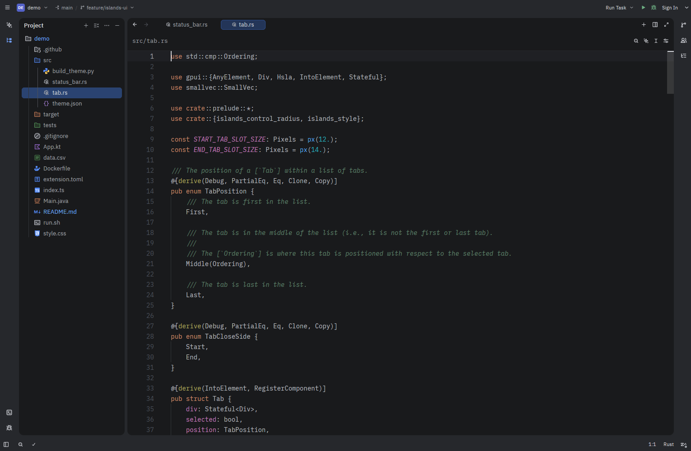
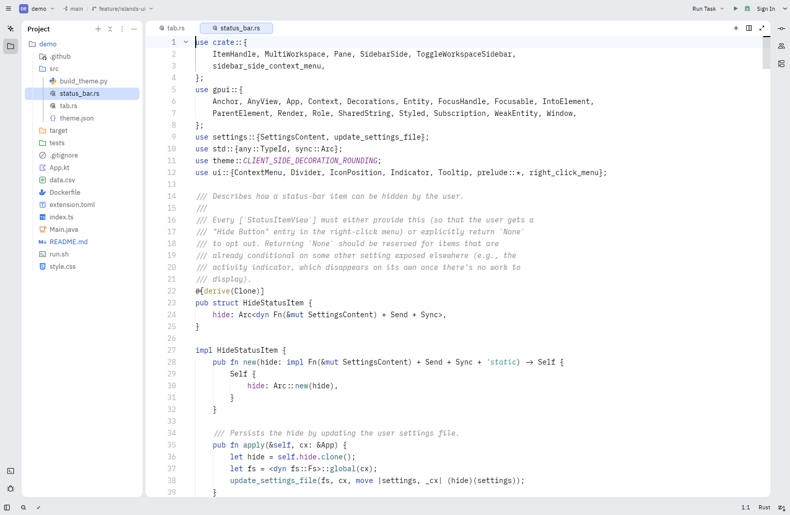

# Islands UI for Zed

Dark and light Zed themes that use the colors of the **Islands** UI from
IntelliJ-based IDEs (IntelliJ IDEA, PyCharm, RustRover, and others).

- **Islands UI Dark**: the "Islands Dark" UI theme plus its editor color scheme.
- **Islands UI Light**: the "Islands Light" UI theme plus the "Light" editor color scheme.

- **Islands UI Icons Dark / Light**: an icon theme with IDEA's new UI file and
  folder icons. Folders named `src`, `test`, `resources`, `target`, `build`,
  `node_modules` and similar get IDEA's source, test, resource and excluded
  folder colors.

Colors are read from JetBrains' Apache-2.0 sources and mapped onto Zed's theme
tokens by `scripts/build_theme.py`. See [NOTICE](NOTICE) for attribution.





## Install (dev extension)

1. Clone this repository.
2. In Zed, open the command palette and run `zed: install dev extension`.
3. Pick the cloned folder, then select **Islands UI Dark** or **Islands UI Light**
   with `theme selector: toggle`, and **Islands UI Icons Dark** or
   **Islands UI Icons Light** with `icon theme selector: toggle`.

Icons cover the file types IDEA ships under Apache-2.0 (Java, Kotlin, Python,
JavaScript, TypeScript, C/C++, C#, PHP, Scala, Swift, web, config and data
files). Languages whose IDEA icons are not open source, such as Rust, Go and
Ruby, keep Zed's default icons.

## Settings for a closer match

Add to your Zed `settings.json`:

```jsonc
{
  "theme": { "mode": "system", "dark": "Islands UI Dark", "light": "Islands UI Light" },
  "icon_theme": { "mode": "system", "dark": "Islands UI Icons Dark", "light": "Islands UI Icons Light" },
  "ui_font_family": "Inter",
  "ui_font_size": 13,
  "buffer_font_family": "JetBrains Mono",
  "buffer_font_size": 13,
  "buffer_line_height": { "custom": 1.4 },
  "tab_bar": { "show_nav_history_buttons": false },
  "toolbar": { "breadcrumbs": false, "quick_actions": false },
  "tabs": { "file_icons": true, "git_status": true },
  "project_panel": { "indent_size": 16 },
  "scrollbar": { "show": "auto" }
}
```

## What a theme cannot do

Zed themes only set colors. The rounded panels separated by gaps that define
the Islands look need a change to Zed itself. The theme gets part of the way
there: window chrome and the borders between panels use the darker "gap" color,
while panels and the editor use the lighter "island" color.

A prototype of the layout change lives on the `islands-layout` branch of
[Zeirison/zed](https://github.com/Zeirison/zed/tree/islands-layout). It draws
the editor and docks as rounded islands, editor tabs as pills, and project
panel rows as inset rounded highlights, and moves panel toggles into IDEA-style
tool window stripes along the window edges. The title bar gets IDEA-style project,
branch and run widgets, and each docked panel gets a header row with its name,
its actions, an options menu and a hide button (the terminal's tabs share that
row, as in IDEA). Stripes and headers use IDEA's
tool window icons, and the status bar shows IDEA's navigation path
(project › folder › file › symbol). Pickers, menus and popups get the islands
corner radius and rounded selection rows. The gutter uses IDEA's green run icons
and hover-only fold arrows, scrollbars are thin and rounded, and notifications
look like IDEA's balloons. `"compact": true` switches to IDEA's compact metrics. With
`"use_system_window_tabs": true` (macOS), merged project windows show as IDEA-style
project tabs with each project's name and initials. Tooltips show the shortcut as
gray text. Double Shift opens Search Everywhere with Files, Symbols, Actions and
Text tabs (Tab switches), Ctrl/Cmd+Shift+F opens a Find in Files popup, and
tasks run in a separate Run tool window (Alt/Cmd+4) with Rerun and Stop buttons.
The fork turns all of this on by default, together with the bundled theme,
Inter and JetBrains Mono, and the JetBrains keymap. Enable it in a regular build with:

```jsonc
"islands": { "enabled": true, "gap": 6, "corner_radius": 10, "tool_window_stripes": true, "navigation_path": true, "compact": false }
```

## Regenerating the theme

```sh
python3 scripts/build_theme.py themes/islands-ui.json
python3 scripts/build_icon_theme.py /path/to/intellij-community .
```

## License

Apache-2.0. Not affiliated with or endorsed by JetBrains.
